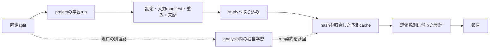

# 実験結果の選択と来歴をそろえるための全体レビュー

2026-10-13。対象はコミット済み実装と未コミット変更全体。基準の HEAD は
`b53c4f88ca28b25d65bd226afd95f0a30d9d1fda`。

**優先すべき修正は、別 run の結果が混ざる経路を閉じ、評価値と checkpoint の対応を正すこと。**
project と study の分離、独立した stage process、解決済み設定の保存、golden 検証は実験基盤として妥当である。
ただし、主結果に使う分析の一部がこの基盤を迂回しており、再実行・再集計の際に結果の同一性を保てない。
前回の指摘に加え、追加レビューでは実装上の問題を8件確認した。設計上の課題は別に記す。

本レビューでは学習を起動せず、コード、既存 run の記録、テスト、最小再現を使った。
論文原典との数式の照合や全結果の再計算は実施していない。以下の指摘から、すべての既存報告値が誤っているとは判断しない。

## 再実行と成果物の選択に、結果を取り違える経路がある

### R1 [P1] Q2 の再実行で、旧 run の epoch が選ばれる

根拠: `analysis/archive/latent_bias_hypernet/export_onestage.py:95-96`、
`analysis/archive/latent_bias_hypernet/q2_fairness_loss.py:70`。

export の出力先は損失・条件・seed だけで決まり、既存 directory を再利用する。新しい run が旧 run より短い場合、
新 run に存在しない後半 epoch の予測が残る。選択側は directory 内の全 epoch を候補にするため、旧 run の予測を選べる。
mock を用いた実際の `export → select_epoch` 呼び出しで、epoch 0 だけの新 run から旧 run の epoch 2 が選ばれることを再現した。
`probes/train_adapter_fair.py:221-222` の再実行にも同じ残存問題がある。

出力を run ID ごとに分け、入力 run・checkpoint hash・split hash・候補 epoch を manifest に残す。
既存 Q2 の出力は、来歴を確認できる run から新しい directory に再 export して再集計する。
2段目で重みを保存していない条件は、予測の来歴を既存記録から確定できなければ再学習が必要になる。

### R2 [P1] SWAD と最悪群評価で、再生成前の cache を採用できる

根拠: `analysis/archive/latent_bias_hypernet/fairness_eval.py:123-125,134-139`、
`analysis/common/predictions.py:411-415`。

予測生成側は checkpoint・split の hash ごとに別の cache を作る。一方、選択側は checkpoint 名が合う最初のファイルを返し、
現在の hash と照合しない。旧 hash と新 hash の cache を置いた最小再現では旧ファイルが選ばれた。
split の内容が変わっても画像 ID が同じなら、行照合だけでは古い予測を除外できない。

現在の checkpoint と split に一致する hash の cache を一意に選び、不一致は再生成対象にする。
修正後は該当する公平性比較を再集計する。保存済み checkpoint があれば、モデルの再学習は不要。

### R3 [P1] iterative の best checkpoint に最終 epoch のスコアを記録する

根拠: `projects/hypernet_iterative/stage.py:78`、`projects/hypernet_iterative/workflow.py:545`。

`best_model_path` の選択スコアに、fit 終了時の `trainer.callback_metrics` を使っている。
実 run `20260929T080251Z-spatial-lora-iterative-chexpert-from-resnet-fc-s42-e582` の stage01 では、
best epoch 0 の AUROC は **0.85958457**、checkpoint に対応づけられた記録は最終値の **0.85511899** だった。
この記録を使った stage 間の選択・比較が誤る。実際の warm-start が変わったとまでは確認していない。

`checkpoint.best_model_score` を保存する。既存記録は CSV と checkpoint の epoch から別の訂正記録を作り、
このスコアを使った選択・集計を再確認する。元の不変 run を直接書き換えない。

## 学習入力とモデルの来歴に、記録から復元できない部分がある

### R4 [P2] 双対更新用 held-out split が manifest に含まれない

根拠: `projects/hypernet_e2e/run_record.py:264`、
`projects/hypernet_e2e/data/group_class_sampler.py:148`。

manifest は train と val のみを記録する。`holdout_split` は実際に双対変数を更新する学習入力だが、
CSV の SHA-256、行集合、ラベル分布が記録されない。held-out CSV を差し替えても記録上の入力を区別できない。

設定された held-out split も manifest に含める。既存 run は、学習時の CSV が残っているかを確認して追加の来歴記録を作る。
後から現在の CSV の hash を採るだけでは、当時と同じ入力だったことの証明にならない。

### R5 [P2] 未コミットの実装を用いた run を、記録された commit から再現できない

根拠: `projects/hypernet_e2e/run_record.py:80,323-325`、
`projects/hypernet_iterative/workflow.py:90,655-657`。

両 project は Git の HEAD を保存するが、実行時の未コミット差分と新規ソースを保存しない。
今回の SWAD・cohort objective などの新規実装は HEAD に含まれないため、同じ commit と config でもモデルを再構築できない。
preflight 成功や checkpoint hash は、実行したソースの保存を代替しない。

起動時に変更差分と実行に関係する未追跡ソースを保存する。依存環境は `uv.lock` の hash と実行環境の版を残す。
dirty tree での実験を許す場合も、来歴からソースを復元できる状態を条件にする。

### R6 [P2] SWAD の評価用重みが run の checkpoint 記録に載らない

根拠: `projects/hypernet_e2e/callbacks/swad.py:178`、
`projects/hypernet_e2e/run_record.py:198-200`。

SWAD は `swad.ckpt` を作るが、recorder は `best_model_path` のない callback を除外する。
実 run `20261010T054745Z-resnet-ham10000-fg-swad-s43-3f4a` でも、SWAD の重みは存在するのに、
記録は通常の best AUROC と worst AUROC の checkpoint のみだった。

平均モデルも選択方式・path・SHA-256 を持つ成果物として記録する。分析側が run 名の `-swad` や固定ファイル名から
選択方式を推測する構造を、明示された checkpoint reference を読む構造へ変える。

## 評価に用いる情報と検証の入口をそろえる必要がある

### R7 [P2] Q3 の属性分析が、モデルに渡した欠損情報を落としている

根拠: `analysis/dataset_gain_sources/data.py:159-163`、
`projects/hypernet_e2e/models/spatial_hypernet/metadata_encoder.py:80-85`。

`AttributeDesign` は categorical の欠損フラグを無視する。CheXpert の AP と ap_pa 欠損は値がともに0なので、
フラグだけ違う2行が同じ説明変数になる。実 test の ap_pa 欠損は **2,915 / 19,617行**。
モデル側は欠損を別の embedding に写すため、「モデルと同じ情報を使う」属性のみ・late fusion の比較条件が成立しない。

categorical の欠損を独立カテゴリへ写し、per-attribute の分析にも同じ扱いを適用する。
属性モデルの再fitとQ3の表の再集計が必要。hypernet 自体の再学習は不要。

### R8 [P2] 文書で定めた全体テストが収集段階で止まる

根拠: `pyproject.toml:55,67` と、新規分析 directory の同名 module。

`uv run pytest -q` は、doctest が `comparison.py` と `operating_point.py` をトップレベルの同名 module として
取り込むため、3件の `import file mismatch` で止まる。`--import-mode=importlib` だけへの変更も、
裸の `from features import ...` などにより14件の import error になった。

分析を通常の package import で読める形にそろえる。`__init__.py`、package 名を付けた import、
pytest の収集方針をまとめて整え、文書の標準コマンドを通す。collection error を隠す除外だけでは解決しない。

## 設計の重点は、主分析を既存の実験契約へ戻すこと

ここからは設計上の判断であり、既存報告値の誤りを確定した指摘とは区別する。

### 主結果を作る学習が、分析用cacheの生成として実装されている

`analysis/archive/latent_bias_hypernet/probes/train_stage1.py` と `train_adapter_fair.py` は独自の学習loopを持つ。
Q1 は前者の `a_s42`、Q2 は後者の出力を使用する。探索用と記されていても、現在は報告の根拠になっている。
Q2 の2段目は予測と log を保存する一方、評価epochのモデル重みを保存しない。
独自loopでは、run ID、状態確定、preflight、W&B、データmanifest、parent checkpoint hash の契約がそろわない。

この構造がR1、R4、R5と共通する問題を増やしている。主結果を生成する学習は既存 project のrunとして残し、
分析は取り込んだrunから予測・表を生成する形へ寄せる。新しい汎用実験frameworkを追加する必要はない。

### 評価の規則は、実装を共有する前に明示する

複数のpackageで同じ名称の指標を計算しているが、セル下限、少数群の除外、しきい値、単一群のgapの扱いが揺れている。
これは前回のTPR/FPR判定とセル下限の不一致にも表れている。

群の定義や研究固有の判断をpackageに残す方針は維持する。そのうえで、セル下限、しきい値の決定split、
bootstrapの単位、checkpoint選択規則を評価条件として保存し、同じ意味の指標はgoldenで縛る。
trainingとanalysis、2つのprojectを一つのPython実装へまとめることは推奨しない。

### cacheの再利用には、行IDと入力hashの両方が必要

`analysis/archive/latent_bias_hypernet/crossfit.py:105-107,120-123` の独自cacheは、存在だけで再利用され、
画像ID・checkpoint hash・split hashを持たない。targetだけの照合では同ラベル行の入れ替えを見つけられない。
`dataset_gain_sources/data.py:116-134` は同じ実験・seedのcacheを上書きして選び、valとtestを別々に探索する。
手元の現行cacheでval/testのrun不一致は見つからなかったが、重複runが入ると一意な比較を保証できない。

既に `analysis/common/predictions.py` にあるhashと行IDの契約を、独自cacheにも適用する。
run名のglob探索から、明示したrunの一覧と成果物referenceを読む形に寄せる。

### 「3 seed」が何を反復したかを報告に残す

`probes/train_adapter_fair.py:75` は親モデルを `a_s42` / `m01_s42` に固定している。
2段目のseedを42・43・44に振っても、1段目の変動を含む3反復にはならない。
固定した親に対する補正の反復としては有効だが、手順全体の安定性を示す結果とは区別する必要がある。

CIが患者の標本誤差を表すのか、学習seedの変動も含むのかを結果表に明記する。
手順全体の再現性を主張する場合は、1段目からseedを対応させて反復する。

## 前回の指摘も修正対象に含める

| 軸 | 指摘 | 根拠 | 必要な対応 |
| --- | --- | --- | --- |
| Spec / P2 | TPR・FPRを両クラスの件数で同時に除外し、群間差を過小評価 | `q1_definitions.py:89-92` | rateごとに独立判定し、Q1・共有処理を使うQ2を再集計 |
| Spec / P2 | セル下限が仕様20件に対し10件 | `q1_definitions.py:48` | 下限を統一し再集計。`e2e_eval.py`の15件も確認 |
| Spec / P2 | held-outのloaderが `num_workers=0` で失敗 | `group_class_sampler.py:175` | `persistent_workers` の設定を反映 |
| Standards / P2 | 学習側runの直接読み込み | `export_onestage.py:15` | packageに取り込んだrunを読む |
| Standards / P3 | `sys.path` の直接変更など、path規約の逸脱 | `fairvlmed_headroom.py:29` ほか | package importとroot解決を統一 |
| Standards / P3 | 新規公開メソッドのdocstring不足 | `swad.py`、`cohort.py` | interfaceの入出力・制約を記す |
| Standards / P3 | 分析側公開関数の `Args:` / `Returns:` 不足 | HAM10000・FairVLMedの `comparison.py` | 群ID・評価集合・戻り値を記す |

## 修正は結果の同一性を回復する順で進める

1. R1・R2・R3と前回の指標定義の不一致を修正し、影響する表を再集計する。
2. 主結果の学習をrun契約へ戻し、ソース、held-out入力、SWADを含む重みの来歴を記録する。
3. R7の属性分析を再fitする。全体テストの収集を直し、run生成から予測・集計までの契約を小さなfixtureで検証する。

モデル本体の大規模な再設計より、これらの経路を先に整える。
現行の実験結果がどの入力・重み・評価規則から得られたかを確定してから、次の比較へ進める。

## 検証記録

- 前回の関連テスト: 230件成功、1件失敗。失敗は `07_two_stage_operating_point.ipynb` の出力保存。
- `uv run pytest -q`: 3件のcollection errorで停止。
- `uv run pytest --import-mode=importlib -q`: 14件のcollection errorで停止。
- `uv run pytest tests projects analysis/tests -q`: 1,032件成功、1件失敗（94.59秒）。失敗は上記と同じnotebookの出力保存。
- R1・R2・R7は最小再現、R3・R6は既存run artifact、R4・R5・R8は実装と標準コマンドで確認した。

実装と既存run artifactは変更していない。今回追加したのは本レビュー文書のみ。
